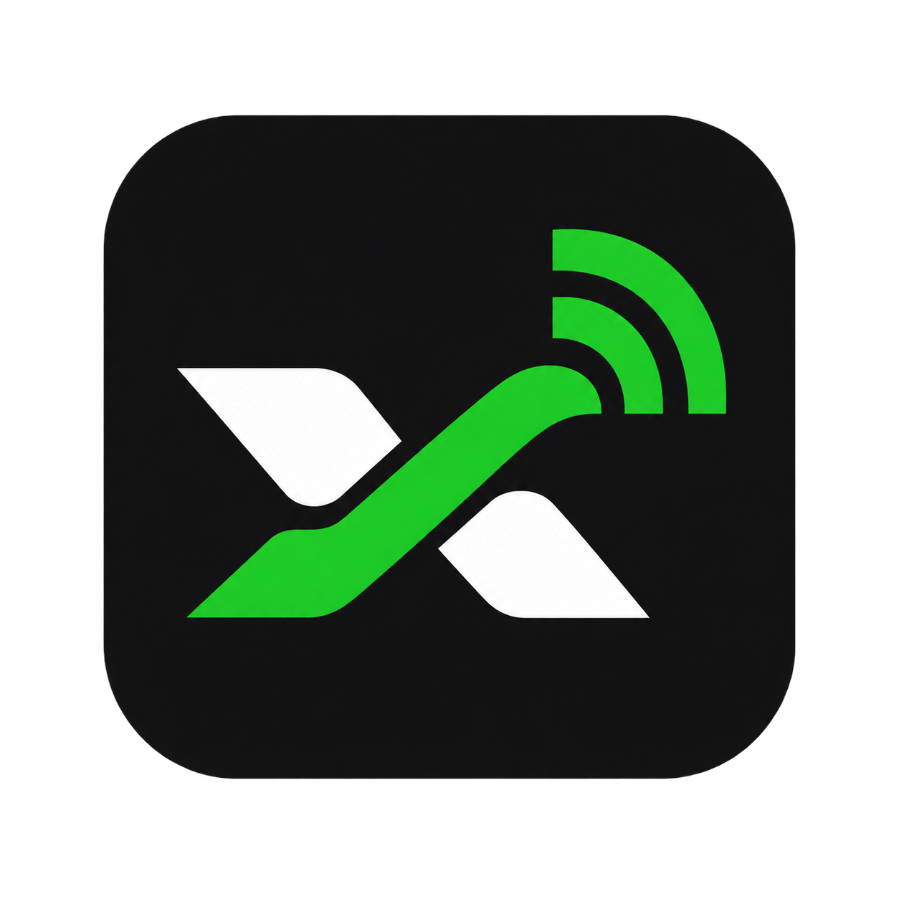
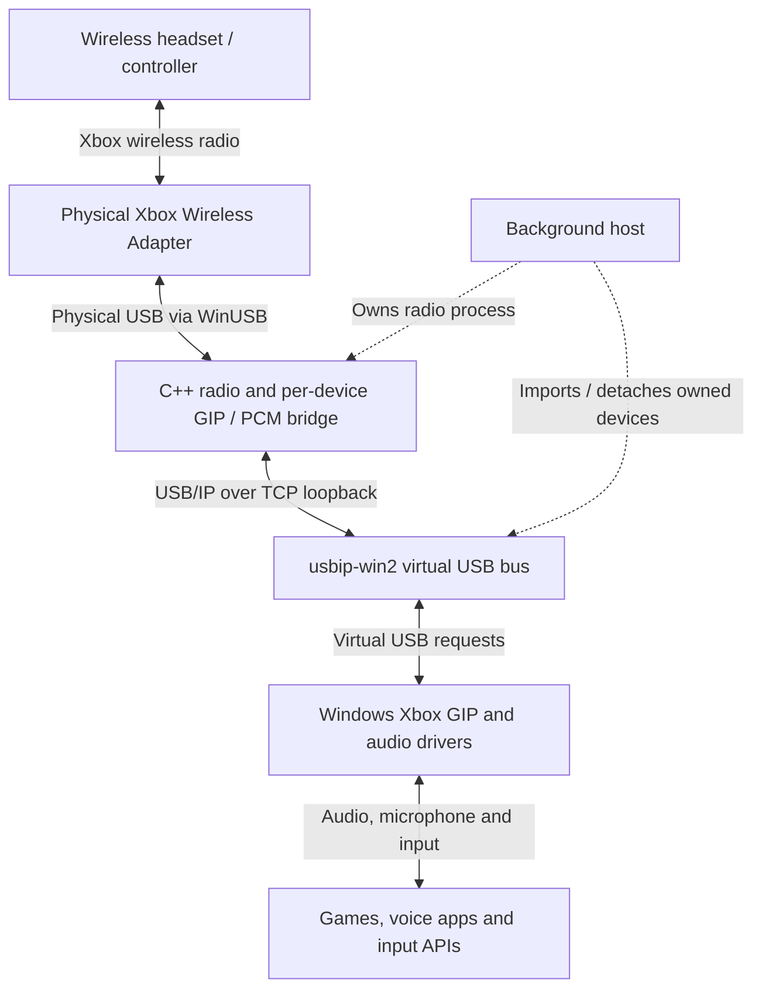

  

# xone Windows Wireless

An experimental C++ bridge for the Xbox Wireless Adapter on Windows 11.
Connect supported Xbox Wireless Headsets and Series controllers through the
adapter while Windows uses its existing Xbox GIP and audio drivers.

**Current release: `0.1.0-alpha.6` (pre-release)** — see the [release notes](docs/releases/RELEASE-alpha.6.md).
**[Download alpha.6 installer for Windows x64](https://github.com/Ktoto59/xone-windows-wireless/releases/download/v0.1.0-alpha.6/xone-windows-wireless-0.1.0-alpha.6-Setup-x64.exe)**
| [Installation and removal](docs/INSTALL.md)
| [Known limitations](docs/LIMITATIONS.md)
| [Troubleshooting](docs/TROUBLESHOOTING.md)
| [Architecture diagrams](docs/ARCHITECTURE.md)
| [Documentation index](docs/README.md)

The [alpha.6 release](https://github.com/Ktoto59/xone-windows-wireless/releases/tag/v0.1.0-alpha.6)
includes Setup, runtime/source archives and SHA256 checksums.

## How it works

Playback, microphone and service messages share the physical adapter. The bridge
uses separate bounded control/media queues and prioritizes waiting service data;
expired audio can be discarded without treating it as a lost radio connection.
The host manages device lifecycle through shared memory and Windows events.
See [component, thread and connection diagrams](docs/ARCHITECTURE.md) for details.

## Changes in alpha.6

- Asynchronous physical USB transmission, bounded control/media queues and USB
  session recovery; wake-capable adapter idle policy with reconnect fallback.
- Runtime status/counters in memory; normal installer builds compile out runtime
  diagnostic journals. Detailed tracing stays available for development.
- Radio Wave branding, integrated startup choices and Start menu start/stop
  shortcuts. Setup remembers startup choices when upgrading.

This remains an alpha. Occasional audio micro interruptions and some cold/warm
reconnect cases still need validation; these changes do not establish a measured
latency improvement or stock-driver reliability.

## Supported hardware

| Device | Supported identity | Status |
| --- | --- | --- |
| External Xbox Wireless Adapter (slim) | USB `045E:02FE` | Physically tested; one adapter per PC |
| External Xbox Wireless Adapter (original) | USB `045E:02E6` | Enabled; hardware validation pending |
| Built-in Xbox Wireless radios | USB `045E:02F9`, `045E:091E` | Enabled; hardware validation pending |
| Xbox Wireless Headset 2021, green rim | RF `045E:0B31`, USB `045E:0B17` | Playback and pairing tested |
| Xbox Wireless Headset 2024 | `045E:0B32` | Playback and pairing tested |
| Xbox Series controller | RF `045E:0B13`, USB `045E:0B12` | Connection and input tested |

These are model IDs, not individual serial numbers. Supported devices are detected
dynamically: there is no compiled address allowlist or developer-specific device
mapping. The four adapter IDs follow the [upstream xone catalog](https://github.com/medusalix/xone/blob/master/transport/dongle.c). Other Xbox-compatible products and unknown adapter variants are not covered. Eight software association slots do not imply support for eight
simultaneous audio streams.

## Quick start

1. On Windows 11 x64, connect the adapter and stop any bridge running from a
   development checkout or a different installation.
2. Download and run `xone-windows-wireless-<version>-Setup-x64.exe` as your
   normal Windows user. Approve the separate administrator prompt for setup.
3. Let Setup prepare WinUSB, verified adapter RAM firmware and the signed USBip
   dependency. Restart Windows or reconnect the adapter if requested.
4. Turn on the device. For first pairing, activate pairing on the device and
   briefly press the adapter's pairing button. Later, use ordinary power-on.
5. Choose the desired headset playback/microphone endpoint in Windows or your app.
   A newly connected headset does not change your default audio selection.

Alpha.6 installers offer separate options to start now and at Windows sign-in;
the older alpha.5.2 installer enables both automatically. Newer Setup can
replace an older version as the same Windows user, retaining private configuration
and recovery data. No prior uninstall is required.

In the development checkout after alpha.6, **Stop xone Wireless** also restores
the Microsoft adapter driver and pauses automatic bridge startup. **Start xone
Wireless** selects WinUSB and restores the saved startup choice. Driver changes
require UAC approval; reconnect/restart instructions are shown when needed. The
published alpha.6 shortcuts only control the bridge process. See
[mode switching](docs/INSTALL.md#switch-between-the-bridge-and-the-microsoft-driver).

The invisible host runs in the installing user's session. No Python installation,
resident PowerShell, tray application or test-signing mode is required. Remove it
through Windows **Installed apps**, keeping the adapter connected. Read the
[full guide](docs/INSTALL.md) before installing or migrating an existing setup.

## Important limitations

- **Do not update headset or controller firmware through the bridge, including
  over-the-air updates offered by Xbox Accessories.** Stop the bridge and use a
  physical USB data cable with the manufacturer's supported update procedure.
  The virtual wired appearance does not make this transport update-compatible.
- The physical adapter is dedicated to this bridge while bound to WinUSB. Its
  stock wireless driver cannot serve other devices in parallel on that adapter.
- USBip remains part of the transport. The project supplies user-mode software,
  not a replacement certified wireless kernel driver. Project EXEs are unsigned;
  the Windows and upstream USBip kernel drivers are signed.
- Xbox Accessories may show **Connected** instead of a wireless battery level.
  Device detection/settings do not imply support for every Accessories operation.
- Controller audio-jack streaming and stock-equivalent wireless authentication/
  encryption are not implemented or established for the raw USB/GIP route.
- Tested on one development PC. Fresh-PC hardware setup/restoration, long-duration
  voice/music use and broad sleep/resume behavior still need validation.

See [all limitations](docs/LIMITATIONS.md), including update instructions and the
difference between adapter RAM firmware and updating a headset.

## Development and privacy

`main` is the stable/release channel; `experimental` holds development work.
The installed runtime and background manager are C++. Development uses the
Python reference with complete source call tracing and a separate anomaly log;
see [development sessions](docs/DEVELOPMENT.md#development-session).
[Build instructions](docs/INSTALLER.md),
[architecture](docs/ARCHITECTURE.md), [development checks](docs/DEVELOPMENT.md),
[changelog](CHANGELOG.md) and [upstream attribution](docs/UPSTREAM.md).
See the [repository map](docs/DEVELOPMENT.md#repository-layout) and
[script guide](scripts/README.md) for the supported entry points and research tools.

The repository and release payloads exclude real device addresses, captured
serials, user SIDs, local configurations, recordings, packet captures, firmware,
driver backups and certificates. Pairing data and recovery state are generated
locally for each installation. Do not upload your complete `work/` or `config/`
directories; see [privacy notes](docs/PRIVACY.md).

GPL-2.0-or-later; third-party notices are preserved. This community research
project is not affiliated with or endorsed by Microsoft or Xbox.
