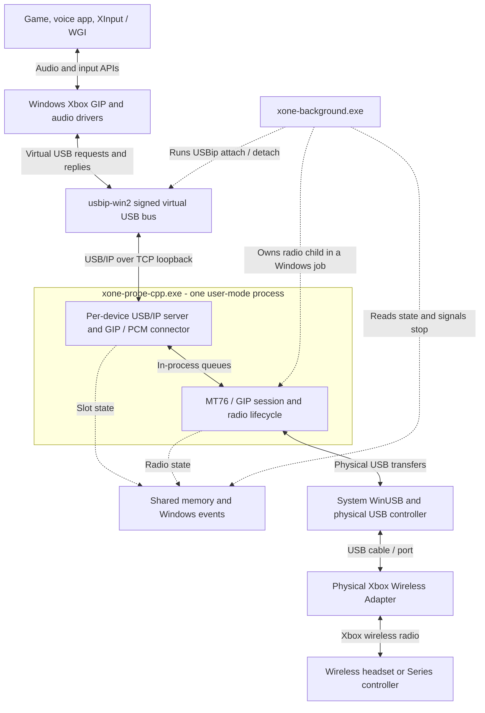
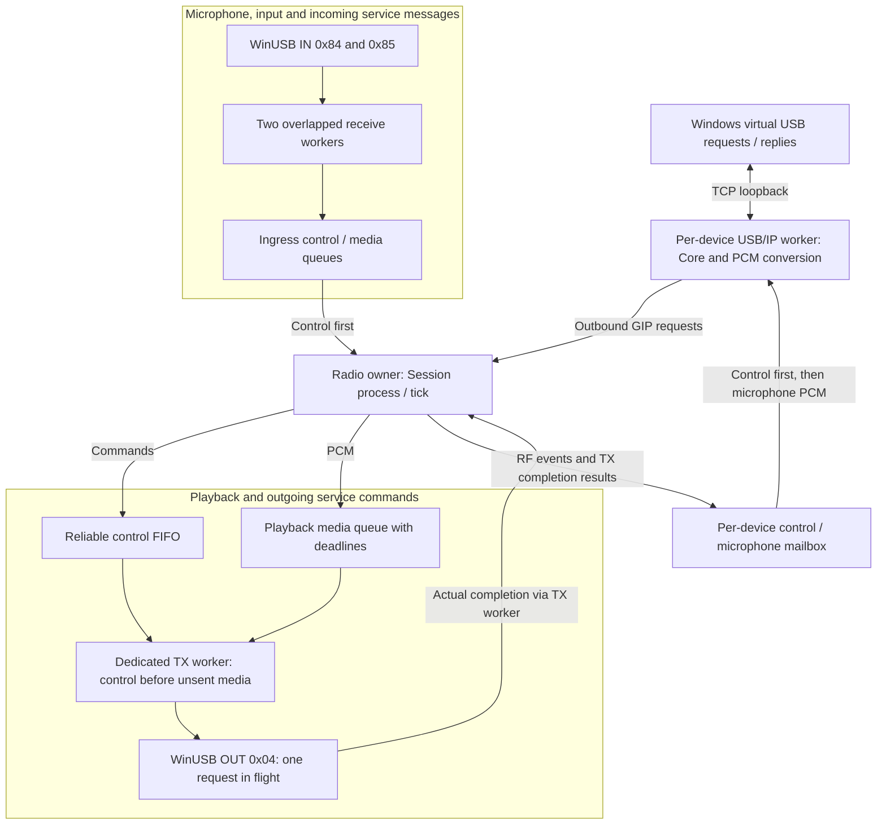
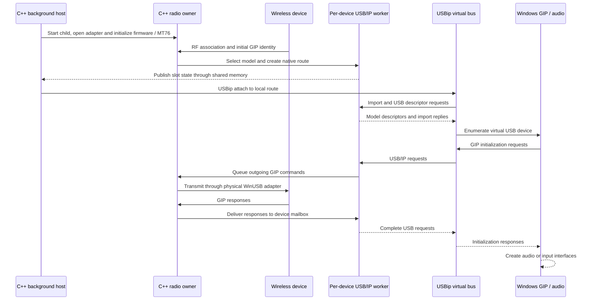

# Architecture

These diagrams describe the native C++ path in the current `experimental`
checkout. Older releases can differ, particularly in file-based status handling.
Python remains a separate development/reference implementation; it is not part of
the installed audio path. Solid arrows show data exchange; dotted arrows show
ownership, state notifications or lifecycle management.

## Component overview

The virtual USB bus presents each supported wireless device to Windows as a
model-specific USB device. It is separate from the physical WinUSB adapter.
Audio, microphone data and GIP commands share that adapter's physical transport;
separate application queues do not create separate physical USB controllers.
Physical keyboard and mouse input does not pass through this bridge. Those
devices can still share a host USB controller, and virtual USB enumeration also
triggers Windows device notifications; this map alone cannot diagnose input lag.

## Threads and traffic

This is a logical view of normal streaming within the radio process. The
USB/IP worker is per virtual device; the receive workers and transmit executor
serve the shared physical adapter. `Session::tick()` moves requests and real
completion results between the radio owner and device routes.

| Traffic | Direction | Queue behavior |
| --- | --- | --- |
| Playback | Windows to headset | Model-specific pacing and deadlines; unsent expired PCM completes as ISO loss |
| Microphone | Headset to Windows | Bounded media queues; stale microphone data can expire |
| Controller input | Controller to Windows | Reliable path, separate from droppable microphone media |
| Service data | Both directions | Identity, initialization, lifecycle, GIP ACKs and controls retain ordering and are not evicted as media |
| Runtime status | Radio/routes to host | Coalesced snapshots in shared memory, outside the audio payload path |

Control has priority over waiting media. An already submitted physical OUT
operation completes or is cancelled before the next one starts. The TX worker
keeps that wait outside the radio owner; startup/teardown MT76 operations still
use synchronous control transfers. Reliable queue overflow and transport errors
are explicit failures. The diagram does not imply unlimited buffering or delivery
through a failed adapter. See [runtime IO](RUNTIME-IO.md) for limits and cancellation.

## Connection sequence

This shows an ordinary supported-device connection after adapter startup. It
omits model-specific handshake details and retries; radio association alone does
not mean that Windows has created usable audio endpoints.

On true RF removal, the host detaches only that route's owned virtual USB port.
A failed USB/audio route may be re-imported while RF remains associated. Expired
media alone does not trigger that recovery. A fatal physical WinUSB failure takes
the radio process through host restart/backoff. The generation and RF epoch checks
prevent an old request from completing in a replacement session; see
[background operation](BACKGROUND-MODE.md) and [headset reconnect](HEADSET-RECONNECT.md).

## Implementation details

| Component | Source |
| --- | --- |
| Host, owned imports and recovery | [background_host.cpp](../src/background_host.cpp) |
| Receive workers and radio loop | [main.cpp](../src/main.cpp) |
| RF/GIP session and TX dispatch | [session.cpp](../src/session.cpp) |
| Model selection and route creation | [native_device_route.hpp](../src/native_device_route.hpp) |
| Per-device USB/IP worker | [usbip_native_output.cpp](../src/usbip_native_output.cpp) |
| USB request / GIP protocol state | [usbip_native_core.cpp](../src/usbip_native_core.cpp) |
| Physical transmit queue and completion | [radio_tx_queue.hpp](../src/radio_tx_queue.hpp) |
| Shared runtime state and stop events | [runtime_state.hpp](../src/runtime_state.hpp) |
| Physical overlapped USB IO | [winusb_transport.cpp](../src/winusb_transport.cpp) |

An invisible C++ host starts at user sign-in, owns the radio process through a
Windows job and imports/detaches only its own USBip ports. PowerShell is used for
setup/removal, not the audio path. Firmware is verified and loaded into adapter
RAM. This is a user-mode bridge using existing kernel drivers.

Announcements select supported models dynamically. Every route owns queues,
control state, tokens, clocks and a generation. Addresses learned locally produce
stable, distinct virtual USB serials; no device instance is baked into a build.
A model's USB descriptors and Windows/GIP interface GUIDs are technical constants.

The 2021/2024 connectors use different audio pacing and render age limits. Radio
blocks are adapted to Windows USB ISO fragments without lossy encoding. See
[USBIP-LATENCY.md](USBIP-LATENCY.md) and [cpp-bridge.md](cpp-bridge.md).

Installed host/radio/slot state uses bounded shared memory and Windows events,
including shutdown. No periodic state files or stop-file polling are used by
the C++ host. Only explicit lifecycle/generation transitions detach a USB import;
an unavailable observation is not a disconnect. Startup configuration and the
firmware are read before streaming. New pairing metadata is cached until shutdown.
See [RUNTIME-IO.md](RUNTIME-IO.md) for execution and cancellation boundaries.

Radio ingress and each native USB worker isolate reliable control/lifecycle/ACK
messages from microphone PCM. Control messages keep FIFO order and a separate
4096-entry capacity. Microphone queues retain at most four transfers per WCID
and expire at 32 ms; a microphone flood cannot evict a service message. Consumers
process bounded batches, with control messages before media and no media passing
a still-queued lifecycle barrier. Disconnect/reassociation invalidates old media.
Mixed or undecodable GIP messages remain reliable rather than being guessed to
be droppable audio.

Playback has a separate path and model-specific media deadline. Before serialized
physical USB writes, controls precede unsent playback while FIFO/peer fairness
is retained within each class. The render deadline follows each native request
to the physical TX stage: unsent stale PCM gets an explicit ISO expiry, preserving
the RF association and USB generation. Real transport failures retain recovery.
The legacy TCP radio broker likewise prioritizes reliable frames but always
finishes a partially sent frame before switching traffic classes.

Native outgoing GIP uses a dedicated bounded executor with one overlapped WinUSB
OUT request in flight. The radio owner handles reception/lifecycle while the
executor waits for USB completion. USB success is not reported at enqueue time.
URB unlink, USB detach/reimport and RF reassociation invalidate stale work; buffers
and OVERLAPPED remain owned until completion/cancellation has been drained.

These are application queues, not additional physical USB endpoints or parallel
writes. Reliable means no silent media-style eviction or expiry: capacity and
transport failures are explicit errors, not a promise of delivery through a
failed adapter. Commands are not blindly replayed; protocol/Windows sequencing
still owns acknowledgements and retries. Queue-pressure drops are logged with
counts at most once per second, not once per microphone packet.

Malformed radio GIP framing is rejected before dispatching any packet from that
transfer. The associated WCID's `MalformedGipPackets` status counter increases;
other devices and later valid packets continue. Dispatch and physical USB errors
still reach the transport recovery path.

The source retains legacy synthetic GIP/ViGEm and Python reference experiments;
these are not installed or selected by the normal runtime. They do not establish
stock wireless auth v3 support, firmware-update support or kernel-driver status.
See [LIMITATIONS.md](LIMITATIONS.md) and [DEVELOPMENT.md](DEVELOPMENT.md).
